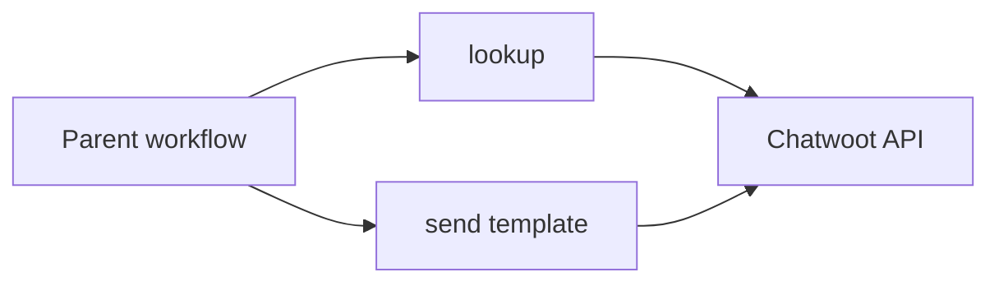

# Chatwoot WhatsApp

Two sub-workflows for a WhatsApp Cloud inbox in Chatwoot. A parent passes a phone number. Neither flow creates contacts.

- [Lookup](lookup/) — search the contact, exact-match on digits, return the conversation on a configured WhatsApp inbox. No writes. `conversation_id` is null when that inbox has no thread.
- [Send template](send-template/) — same lookup, then send a named template with variables. If the thread is missing, create the contact inbox and the conversation, then send.

Send repeats the lookup steps inside its own file, so each `workflow.json` imports alone.

## After import

On each workflow, fill `Config`:

- `base_url` — Chatwoot origin, no trailing slash
- `account_id`
- `whatsapp_inbox_id`

Attach **HTTP Header Auth** on every Chatwoot HTTP node:

- Chatwoot 4.19+: header `Authorization`, value `Bearer <user access token>`
- Older installs: header `api_access_token`, value the token

Call either flow with **Execute Sub-workflow**. Do not turn them active; they have no trigger of their own.
