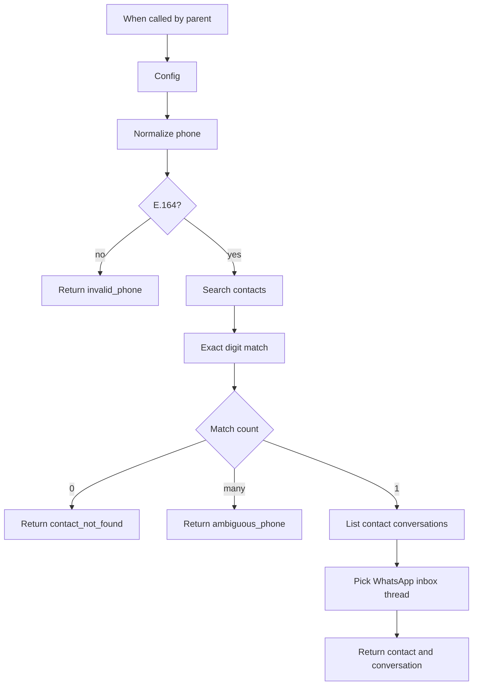

# Lookup contact and WhatsApp conversation

[`workflow.json`](workflow.json)

Sub-workflow. A parent passes `phone` in E.164 (`+9665…`). This flow searches Chatwoot, exact-matches the contact on digits, and returns that contact's conversation on the configured WhatsApp inbox.

It does not create contacts, contact inboxes, or conversations. `ok` stays true when the contact exists and `conversation_id` is null.

Parent: [Chatwoot WhatsApp](../)

## After import

Fill `Config`:

- `base_url` — Chatwoot origin, no trailing slash (`https://example.chatwoot.com`)
- `account_id`
- `whatsapp_inbox_id` — the WhatsApp Cloud inbox to pick a thread from

Attach **HTTP Header Auth** on `Search contacts` and `List contact conversations`:

- Chatwoot 4.19+: header `Authorization`, value `Bearer <user access token>`
- Older installs: header `api_access_token`, value the token

Call it from another workflow with **Execute Sub-workflow**. Input is `phone` only.

## Return

Success:

- `ok`, `phone`, `contact_id`, `contact_name`, `inbox_id`
- `source_id` — WhatsApp `wa_id` on that inbox, or null if the contact has no contact inbox there
- `conversation_id` — null when that inbox has no thread
- `conversation_status`

Misses: `ok: false` and `reason` of `invalid_phone`, `contact_not_found`, or `ambiguous_phone`.

Search `q` also hits name and email. The digit match is what makes this a phone lookup. Two contacts with the same digits stop as `ambiguous_phone`. A leading `+` is required; this flow does not guess a country code.
