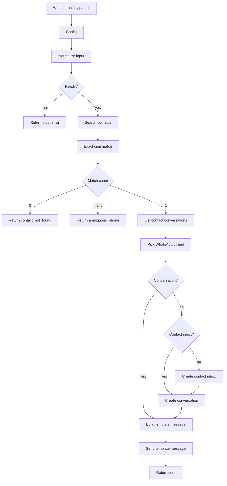

# Send a WhatsApp template

[`workflow.json`](workflow.json)

Sub-workflow. A parent passes a phone number and a template name. This flow finds the contact, picks their conversation on the configured WhatsApp inbox, and sends that template with variables.

If the contact exists but that inbox has no thread, it creates the contact inbox when missing, opens a conversation, then sends the template. It does not create contacts. A phone with no contact stops.

The lookup steps are repeated here so this file imports alone. There is no sub-workflow id to re-link. The read-only version is [lookup](../lookup/).

Parent: [Chatwoot WhatsApp](../)

## Inputs

| Field | Required | Role |
| --- | --- | --- |
| `phone` | yes | E.164, for example `+966551234567` |
| `template_name` | yes | Approved WhatsApp template name |
| `language` | yes | Approved locale, for example `en_US` |
| `category` | no | `UTILITY`, `MARKETING`, `SHIPPING_UPDATE`, `TICKET_UPDATE`, or `ISSUE_RESOLUTION`. Defaults to `UTILITY` |
| `variables_json` | no | Object string. Body variables, positional (`{"1":"Ali"}`) or named (`{"customer_name":"Ali"}`) |
| `processed_params_json` | no | Full `processed_params` when the template has a header or buttons. When set, it wins over `variables_json` |

## After import

Fill `Config` with `base_url` (no trailing slash), `account_id`, and `whatsapp_inbox_id`.

Attach **HTTP Header Auth** on every Chatwoot HTTP node:

- Chatwoot 4.19+: header `Authorization`, value `Bearer <user access token>`
- Older installs: header `api_access_token`, value the token

## Return

Success: `ok: true`, `phone`, `contact_id`, `conversation_id`, `created_conversation`, `message_id`.

Misses return `ok: false` and `reason`:

- `invalid_phone`, `invalid_template`, `invalid_variables`, `invalid_processed_params`
- `contact_not_found`, `ambiguous_phone`

HTTP 401 and 422 still fail the node. A template name or language Meta has not approved comes back as 422 from Chatwoot.

## Edges that break this in production

`language` must be the approved locale. `en` and `en_US` are different templates. Body keys must match the template (`"1"` vs `customer_name`). Pass `category` when the template is not `UTILITY`.

WhatsApp sends the approved template from `template_params`. This flow does not load the inbox template catalog. `content` is the template name, so the Chatwoot transcript shows that name. Chatwoot only substitutes `processed_params.body` into `content` when `content` is the raw template body and `template_params.content_mode` is `raw_template`.

Chatwoot's create-conversation docs list Website, Phone, API, and Email only. This example still creates on a WhatsApp Cloud inbox: `POST /contacts/{id}/contact_inboxes` with `source_id` set to the E.164 digits (the WhatsApp `wa_id`, no `+`), then `POST /conversations` with that `source_id` and no session text. A plain text message on create fails outside the 24-hour window. The template is a separate `POST /conversations/{id}/messages` using `template_params`.

This targets WhatsApp Cloud. Twilio and 360dialog content templates use a different payload.

Search `q` also hits name and email. The digit match is the phone lookup. Two contacts with the same digits return `ambiguous_phone`. A leading `+` is required; the flow does not guess a country code.
