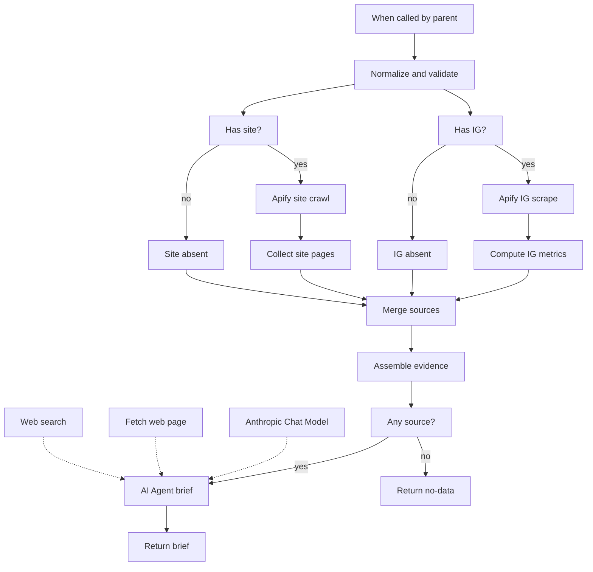

# Lead brief (Instagram + site)

[`workflow.json`](workflow.json)

Sub-workflow: a parent flow passes `instagram`, `website`, and `name`. This flow scrapes public Instagram and crawls the site (Apify), merges evidence, then an AI agent writes a cited lead brief (observed vs inferred vs unknown).

Call it from another workflow with an **Execute Sub-workflow** node. It is not a standalone webhook.

## After import

Attach:

- **HTTP Query Auth** (Apify API token as the `token` query param) on `Apify — IG scrape`, `Apify — Site crawl`, `Fetch web page`, and `Web search`
- **Anthropic** on `Anthropic Chat Model`
