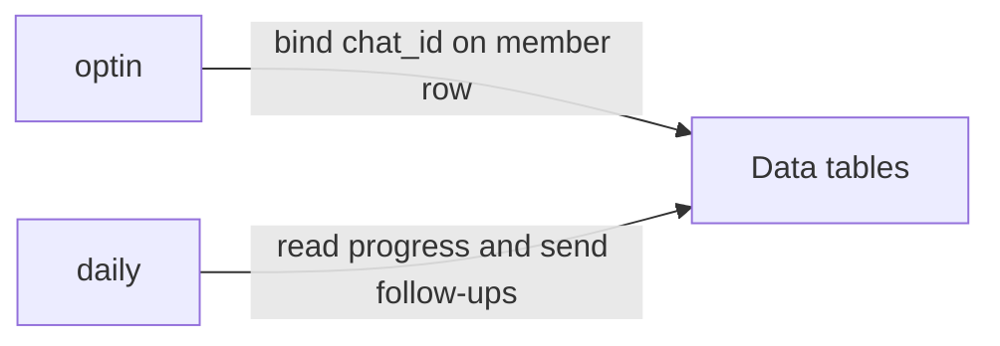

# Teachable course follow-up (Telegram)

Two connected workflows. Students message the bot, bind their purchase email, then receive progress DMs and an optional channel scoreboard.

- [Opt-in](optin/) — Telegram `/start` → match purchase email → store `telegram_chat_id` → welcome DM
- [Daily](daily/) — fetch each member's Teachable progress, DM if due, post a batch scoreboard to a channel

Opt-in writes the roster; the daily job reads it.

## Data tables

You do **not** need to upload student rows. Recreate two empty n8n Data Tables from:

- [`datatables/course-telegram-members.schema.json`](datatables/course-telegram-members.schema.json)
- [`datatables/course-telegram-batches.schema.json`](datatables/course-telegram-batches.schema.json)

After import, re-select those tables on every Data Table node. Fill `Config` with your Teachable course id, Telegram channel id / invite link, and attach:

- **Telegram** on the trigger and send nodes
- **HTTP Header Auth** (Teachable API key) on the progress HTTP nodes

Showcase defaults: opt-in `test_mode=true` (no replies unless `test_chat_ids` is set); daily `dry_run=true` (progress still updates, nothing is sent).
