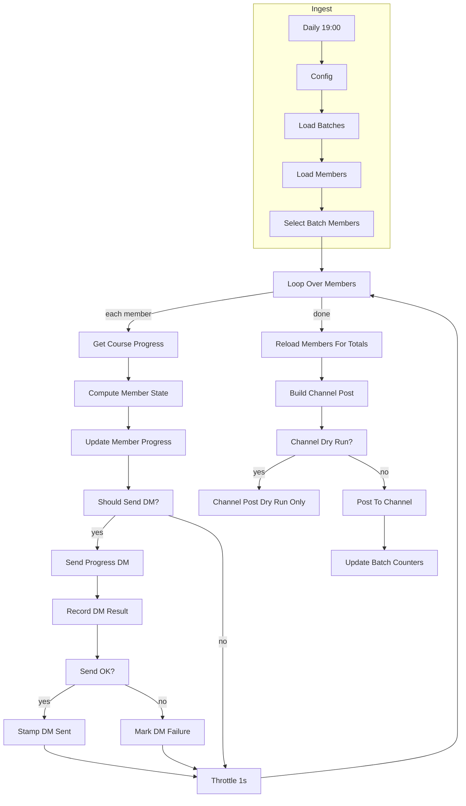

# Daily

[`workflow.json`](workflow.json)

Scheduled job: fetch each member's Teachable progress one-by-one, update the roster, DM if due, then post a batch scoreboard to a Telegram channel.

Parent: [Teachable course follow-up](../)

