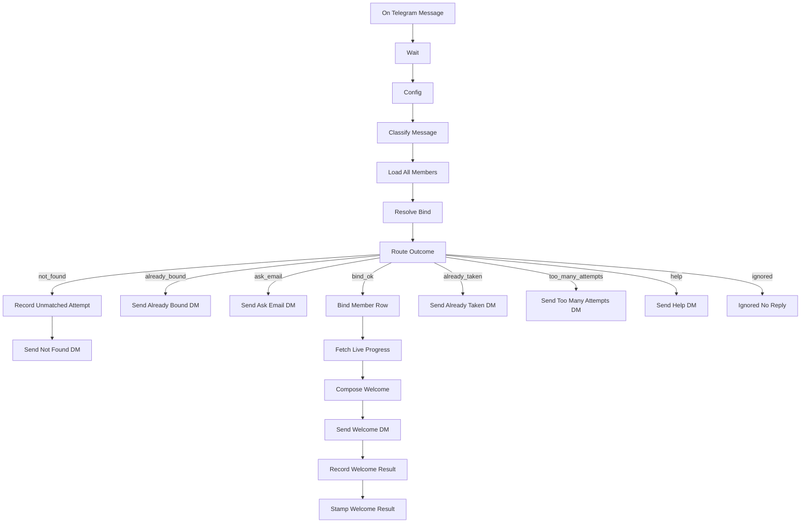

# Opt-in

[`workflow.json`](workflow.json)

Telegram `/start` → ask for the purchase email → match `email_norm` against the members table → store `telegram_chat_id` → welcome DM with live Teachable progress and a channel invite.

Parent: [Teachable course follow-up](../)

